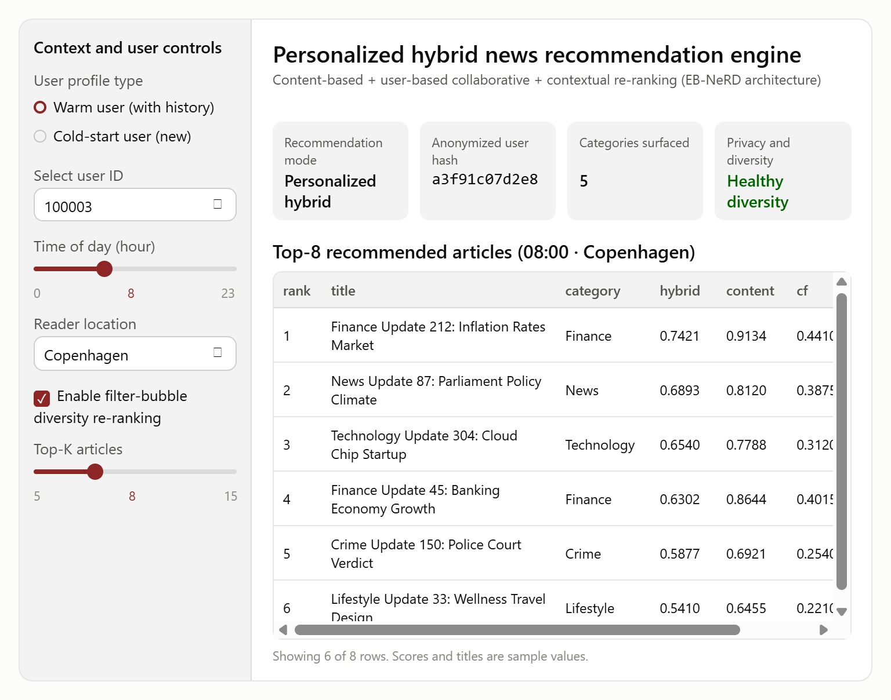

# Hybrid News Recommendation System

A personalized news recommender that combines **content-based filtering**, **user-based collaborative filtering**, and **contextual re-ranking**, with a built-in **cold-start fallback**, **diversity-aware re-ranking**, and a **privacy and filter-bubble audit**. It is built on the [EB-NeRD](https://recsys.eb.dk/) (Ekstra Bladet News Recommendation Dataset) schema and ships with an interactive Streamlit dashboard.



---

## Table of contents

- [Features](#features)
- [How it works](#how-it-works)
- [Project structure](#project-structure)
- [Getting started](#getting-started)
- [Using real EB-NeRD data](#using-real-eb-nerd-data)
- [Running the dashboard](#running-the-dashboard)
- [Offline evaluation](#offline-evaluation)
- [Python API](#python-api)
- [Ethics and privacy](#ethics-and-privacy)
- [Running in Google Colab](#running-in-google-colab)
- [Troubleshooting](#troubleshooting)
- [Contributing](#contributing)

---

## Features

- **Hybrid ranking** that blends content similarity, collaborative signals, and contextual relevance into one score.
- **Content-based engine** using TF-IDF and TruncatedSVD embeddings, with recency-weighted user interest profiles.
- **User-based collaborative filtering** using a sparse user-item matrix and cosine neighborhood scoring.
- **Contextual scoring** covering article freshness decay, time-of-day category alignment, and regional boosts.
- **Cold-start handling** that switches new users to a trending and CTR-based fallback.
- **Real-time feedback loop** that updates a user profile as soon as they click an article.
- **Diversity re-ranking** using an MMR-style category saturation penalty to reduce filter bubbles.
- **Offline evaluation and ablations** with Precision@K, Recall@K, F1@K, NDCG@K, and MRR against Random, Pure Recency, and Most Popular baselines.
- **Privacy audit** that hashes user IDs and reports category diversity.
- **Synthetic data fallback**, so the project runs out of the box without the full dataset.

## How it works

```
Articles ──► TF-IDF ──► SVD embeddings ──┐
                                         ├──► Content score ──┐
User history + train clicks ─► Profiles ─┘                    │
                                                              ├──► Hybrid score ──► Diversity re-rank ──► Top-K
User-item matrix ──► Cosine neighbors ──► CF score ───────────┤
                                                              │
Time of day + freshness + location ──► Context score ─────────┘

Cold-start user? ──► 0.65 × trending + 0.35 × context
```

**Scoring for warm users**

| Component | Default weight | Signal |
|-----------|----------------|--------|
| Content | 0.45 | Cosine similarity between user profile and article embedding |
| Collaborative | 0.30 | Weighted clicks of the top-25 most similar users |
| Context | 0.25 | Freshness decay, time-of-day category fit, location match |

Weights and the diversity penalty are configurable on `HybridNewsRecommender`.

## Project structure

```
.
├── app.py                        # Streamlit dashboard
├── news_recommender_colab.py     # Core library: pipeline, models, evaluation, ethics audit
├── dashboard.jpeg                # Dashboard screenshot used in this README
├── requirements.txt              # Python dependencies
├── data/                         # (optional) EB-NeRD parquet files, not committed
└── README.md
```

### Main components

| Class | Responsibility |
|-------|----------------|
| `DataEngineeringPipeline` | Loads and standardizes parquet files, builds NLP vectors, creates temporal and cold-start splits |
| `ContentAndContextualEngine` | User profiles, contextual scoring, trending fallback, online profile updates |
| `UserBasedCollaborativeFilter` | Sparse interaction matrix and neighborhood-based CF |
| `BaselineRecommenders` | Random, Most Popular, and Pure Recency baselines |
| `HybridNewsRecommender` | Ensemble scoring, cold-start switching, diversity re-ranking, recommendation API |
| `EvaluationAndEthicsSuite` | Ranking metrics, ablation study, privacy and diversity audit |

## Getting started

### Prerequisites

- Python 3.9 or newer
- pip

### Installation

```bash
git clone https://github.com/OWNER/REPO.git
cd REPO

python -m venv .venv
# Windows
.venv\Scripts\activate
# macOS / Linux
source .venv/bin/activate

pip install -r requirements.txt
```

Example `requirements.txt`:

```
pandas
numpy
scipy
scikit-learn
pyarrow
streamlit
```

## Using real EB-NeRD data

Place the extracted dataset files under `data/`. The loader searches the folder recursively, so nested paths work:

```
data/
├── articles.parquet
└── train/
    ├── behaviors.parquet
    └── history.parquet
```

If no parquet files are found, the system automatically generates a small synthetic dataset with the same schema, which is handy for quick testing and demos.

## Running the dashboard

From the project folder:

```bash
python -m streamlit run app.py
```

Then open the local URL Streamlit prints, usually `http://localhost:8501`.

**Sidebar controls**

- **User profile type:** switch between a warm user (with history) and a cold-start user.
- **Time of day:** simulate morning, midday, or evening reading context.
- **Reader location:** apply a regional boost.
- **Diversity re-ranking:** turn the filter-bubble mitigation on or off.
- **Top-K:** choose how many articles to show.

**Dashboard outputs**

- Recommendation mode (personalized hybrid or cold-start fallback)
- Anonymized user hash
- Number of categories surfaced
- Diversity status
- Ranked table with hybrid, content, collaborative, and context scores

## Offline evaluation

Run the full pipeline and print the evaluation tables:

```bash
python news_recommender_colab.py
```

This produces:

1. An **ablation table** on the warm-user test split comparing Random, Pure Recency, Most Popular, User-Based CF, Content-Based Only, Content + Context, and the full Hybrid Ensemble.
2. A **cold-start table** on held-out users comparing Most Popular, Pure Recency, and the Hybrid model.
3. A sample **ethics and privacy audit**.

Metrics reported: Precision@5, Recall@5, F1@5, NDCG@5, and MRR.

> The synthetic dataset is intentionally easy (users strongly prefer one category), so its scores are not representative of real-world performance. Use the real EB-NeRD data for meaningful results.

## Python API

```python
from news_recommender_colab import (
    DataEngineeringPipeline,
    ContentAndContextualEngine,
    UserBasedCollaborativeFilter,
    HybridNewsRecommender,
)

pipe = DataEngineeringPipeline(data_dir="./data")
pipe.extract_and_load()
pipe.build_nlp_representations()
train_df, val_df, test_df, cold_df, cold_users = pipe.create_splits()

content = ContentAndContextualEngine(pipe)
content.build_user_profiles(train_df, cold_users)

cf = UserBasedCollaborativeFilter(pipe)
cf.fit(train_df, cold_users)

model = HybridNewsRecommender(pipe, content, cf)
recs = model.recommend(user_id=100003, top_k=10, user_location="Copenhagen")
print(recs[["rank", "title", "category", "hybrid_score", "mode"]])

# Real-time feedback: update the profile when the user clicks an article
content.update_user_profile_online(user_id=100003, clicked_article_id=9000042)
```

## Ethics and privacy

- **Anonymization:** user IDs are shown only as salted SHA-256 hashes in the dashboard audit.
- **Filter-bubble mitigation:** an optional re-ranker penalizes repeated categories so users see a broader mix.
- **Diversity audit:** the share of unique categories in each recommendation list is reported, with a warning when it is too concentrated.
- **Cold-start fairness:** new users get trending and contextual recommendations instead of empty results.

Note: the trending fallback favors popular content by design, so it can reinforce popularity bias. Review this before any production use.

## Running in Google Colab

```python
!pip install -q pyarrow scikit-learn scipy streamlit pyngrok pandas numpy
%cd /content
!streamlit run app.py &>/content/logs.txt &
!npx localtunnel --port 8501
```

Upload `app.py` and `news_recommender_colab.py` to `/content` first. If localtunnel asks for a password, run `!curl ipv4.icanhazip.com` and enter the IP it prints.

## Troubleshooting

| Problem | Fix |
|---------|-----|
| `ModuleNotFoundError: No module named 'news_recommender_colab'` | Make sure `app.py` and `news_recommender_colab.py` are in the same folder, and run Streamlit from that folder. Check the filename has no `(1)` suffix or hidden `.txt` extension. |
| App shows synthetic data | The parquet files weren't found in `./data`. Check the folder layout above. |
| Slow first load | The model builds on first run and is cached by Streamlit afterward. Full EB-NeRD data takes longer than the demo data. |
| `streamlit` command not found | Use `python -m streamlit run app.py`. |

## Contributing

1. Create a feature branch: `git checkout -b feature/your-feature`
2. Commit your changes: `git commit -m "Describe your change"`
3. Push the branch: `git push -u origin feature/your-feature`
4. Open a Pull Request.

Add `data/` and `__pycache__/` to `.gitignore` so datasets and caches aren't committed.

## License

Add a license of your choice (for example MIT) in a `LICENSE` file.

## Acknowledgments

- [EB-NeRD](https://recsys.eb.dk/): Ekstra Bladet News Recommendation Dataset, used for the data schema.
- Built with pandas, scikit-learn, SciPy, and Streamlit.
